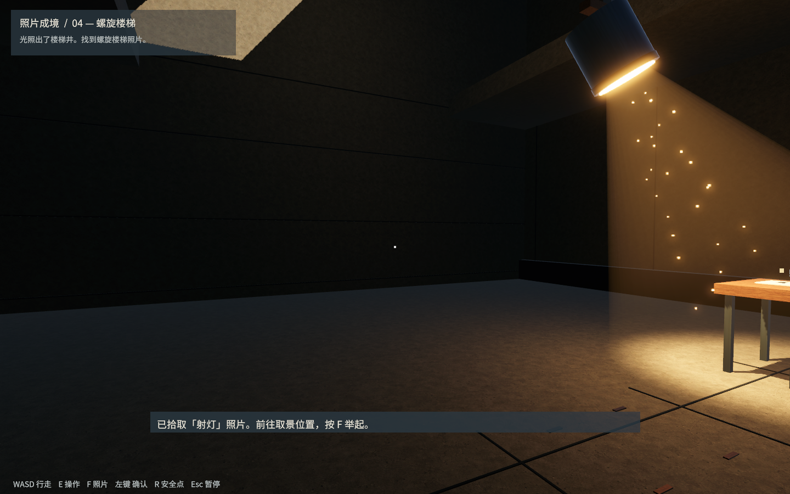
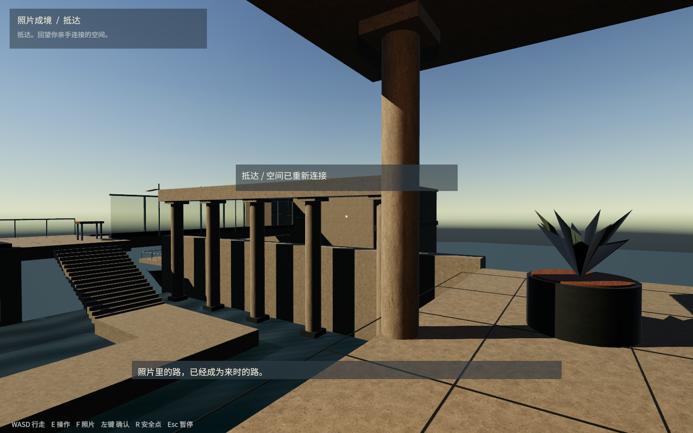

# pic2real

## demo1 照片成境

**这是一个仍然很粗糙的第一人称建筑交互原型。** 当前主要验证「照片变成真实空间」这一机制，以及一条从起点走到终点的基本关卡流程。现有场景、节奏、玩法和画面都需要继续优化，不代表最终美术与游戏品质。

Unity 工程位于 **[demo1](demo1/)**，使用 Unity **6.3 LTS / 6000.3.16f1** 和 URP **17.3.0**。

### 设计思路

玩家从一处露台出发，目标是抵达远处悬空岛屿上的亭子。途中会遇到断桥、封闭入口、黑暗房间、高差、横风和积水等障碍。玩家拾取建筑构件或设备的照片，在对应位置举起并对准，让照片中的物体成为场景中真实存在、可以使用的东西。

希望建筑参与解题：桥连接空间，门穿越边界，光揭示路径，螺旋楼梯改变高度，挡风屏创造背风通道，排水改变空间的可达性。

当前版本采用**固定取景位置、预设照片和预制三维部件**。重点是实现可理解、可进入的空间变化，暂不支持任意照片或任意地点放置，也没有使用 AI 从照片自动重建三维模型。

### 参考作品

核心灵感来自 Sad Owl Studios 的 **[Viewfinder 取景器](https://thunderfulgames.com/games/viewfinder/)**：二维照片放入环境后成为可进入的三维空间，并改变原有场景。

本原型把这一概念收敛为一条固定的建筑体验路线，同时尝试让照片里的设备影响光、风、水等环境条件。[开发者对原作机制的介绍](https://blog.playstation.com/2023/06/08/create-destroy-and-rewind-in-viewfinder-out-july-18-play-the-demo-today/)

### 基本关卡流程

| 顺序 | 照片 | 大概的关卡设计 |
| --- | --- | --- |
| 1 | 桥 | 补上断开的桥段，走到塔楼前的平台。 |
| 2 | 门 | 在封闭墙面生成入口，开门进入暗室。 |
| 3 | 射灯 | 照亮暗室，把下一张照片和前进方向显示出来。 |
| 4 | 螺旋楼梯 | 生成实体台阶，绕行上升至建筑上层。 |
| 5 | 挡风屏 | 连廊上的横风会把人吹向侧边；放置屏障后沿背风区域通过。 |
| 6 | 排水装置 | 抽走庭院积水，让水下的台阶和步道显露出来，最后抵达亭子。 |

全程第一人称，不显示角色身体或手部模型，举片时直接在视野前方呈现照片。当前是单一路线，解谜深度、自由度和失败反馈都还需要打磨。

### 简单玩法

| 输入 | 操作 |
| --- | --- |
| WASD / 方向键 | 行走 |
| 鼠标 | 观察 |
| E | 拾取照片、开门、启动水泵 |
| F | 举起或收起照片 |
| 鼠标左键 | 对齐后确认，让照片成真 |
| R | 返回当前安全点 |
| Esc | 暂停或继续 |

先到桌面附近拿照片，再走到提示的取景位置使用。门和水泵显现后需要再按 E 操作。失足后会回到安全点，已完成的环境变化保留。

### 如何运行

1. 在 Unity Hub 中添加仓库里的 `demo1/` 文件夹。
2. 使用 Unity `6000.3.16f1` 打开，等待包和素材导入。
3. 打开 `Assets/Scenes/PhotoRealm.unity`，点击 Play，再点击「进入 / 继续」。

建筑在运行时生成，因此未进入 Play 时，编辑器场景里不会直接显示完整建筑。Mac 构建方式和源码说明见 [demo1 README](demo1/README.md)。仓库提供工程源码、必要素材及少量检查截图，构建产物和 Unity 缓存不纳入版本管理。

### 当前状态与待优化内容

基本路线已经通过自动通关验证，也进行过人工试玩。自动验证覆盖照片使用限制、螺旋楼梯行走、侧风与挡风、排水、终点和安全点恢复；这不等于已经完成全面的手感或兼容性测试。

接下来重点优化：

- **场景：** 建筑尺度、空间关系、构造细节、引导与环境叙事。
- **节奏：** 行走距离、拾取与举片的停顿、机关反馈和通关时长。
- **玩法：** 对位操作的参与感、关卡变化、照片之间的组合和失败反馈。
- **画面：** 材质、光照、照片显影衔接、风水效果和整体视觉完成度。

下面是当前粗糙版本的实际运行截图，仅用于记录阶段状态：

